# Logic-Electric Circuit Builder

**Draw circuits and simulate them inside Obsidian, on desktop, tablet and phone.**

A clean, intuitive workspace for complete electrical and logic schematics. Search 72 symbols, wire them with precise routing, then switch to **Simulate** to analyse the circuit live: an oscilloscope with probes and cursors, operating-point tables, truth tables and readings in engineering units. Keep each diagram beside the notes that explain it, offline and in your vault.

**72 built-in symbols · Live logic & electrical simulation · Scope, probes & truth tables · Live note previews · SVG & PNG export**

## Your circuits, inside your notes

Embed a live circuit preview in a study note, lab notebook or project write-up, and open the original whenever you want to edit or simulate it.

| Logic · light theme | Electrical · dark theme |
| --- | --- |
| [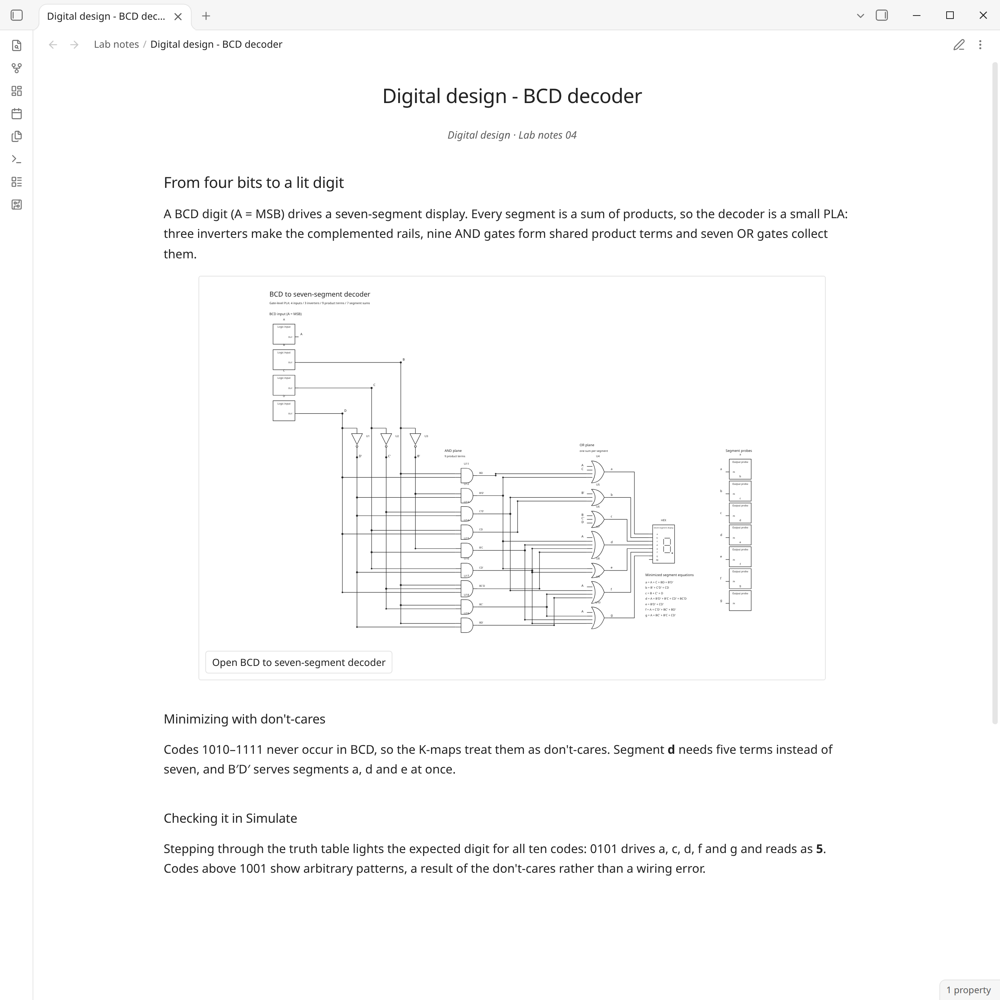](docs/screenshots/note-logic-light.png) | [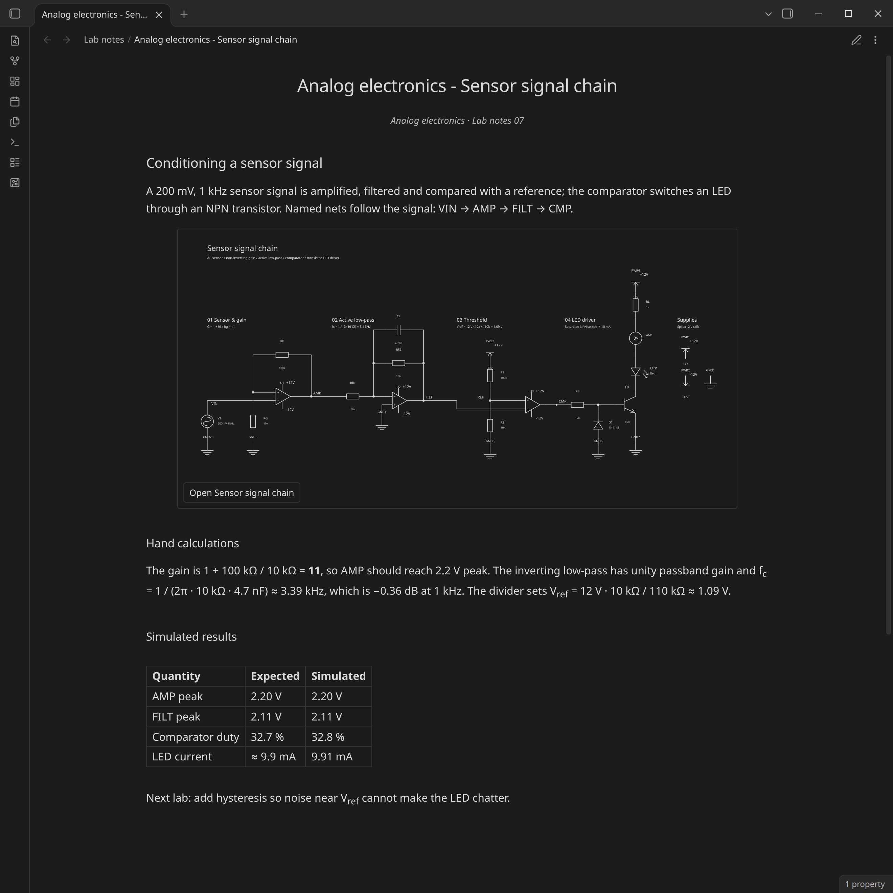](docs/screenshots/note-electrical-dark.png) |

[Try these lab notes and their editable circuits](examples/notes/README.md).

## Build it, then simulate it

One click on **Simulate** turns the editor into an analysis studio. Probe any wire or part, place cursors on the scope and read min, max, RMS, peak-to-peak and frequency for every trace. Hover a transistor for VBE, VCE and collector current, or flip logic inputs and watch every net, lamp and segment update.

[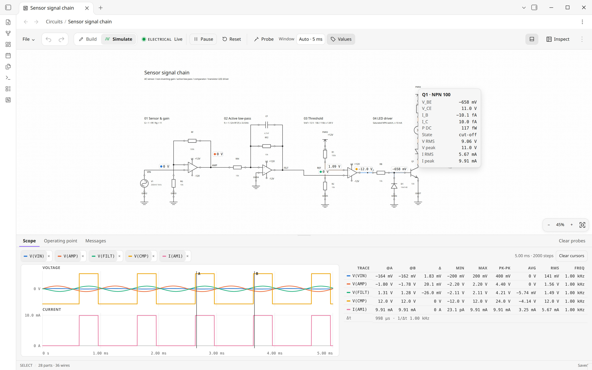](docs/screenshots/desktop-5-electrical-simulation.png)

| Build: gate-level logic | Simulate: truth table | Build: parts library |
| --- | --- | --- |
| [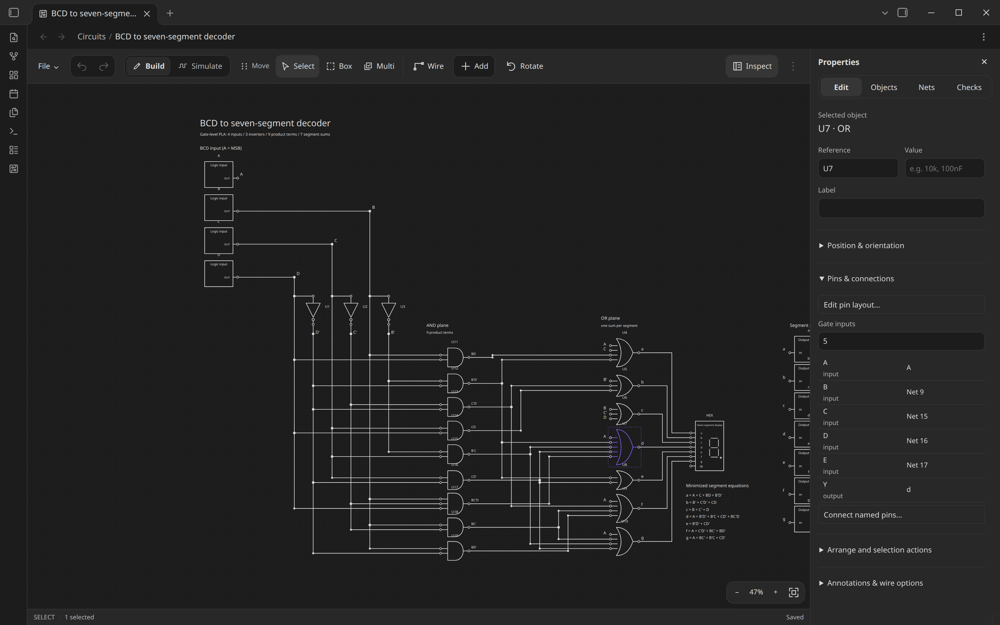](docs/screenshots/desktop-2-logic-build.png) | [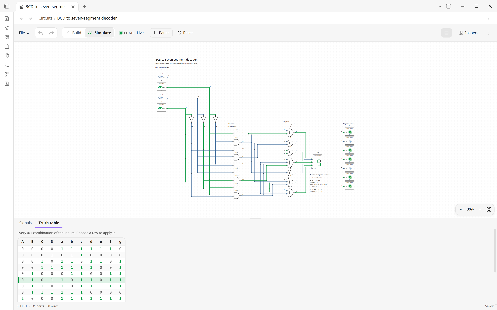](docs/screenshots/desktop-3-logic-simulation.png) | [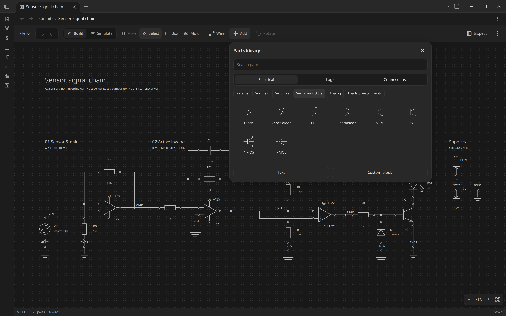](docs/screenshots/desktop-4-electrical-build.png) |

## Take your circuits with you

The same editor and simulator on your phone or tablet. Swipe to pan, pinch to zoom, tap to place parts, connect pins, flip inputs or probe a net. A dockable toolbar keeps the main tools together, and the analysis panel sits below the drawing.

  <a href="docs/screenshots/phone-1-note.png">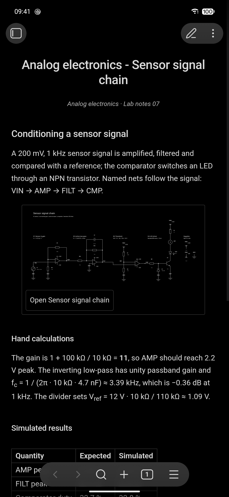</a>
  <a href="docs/screenshots/phone-2-logic-build.png">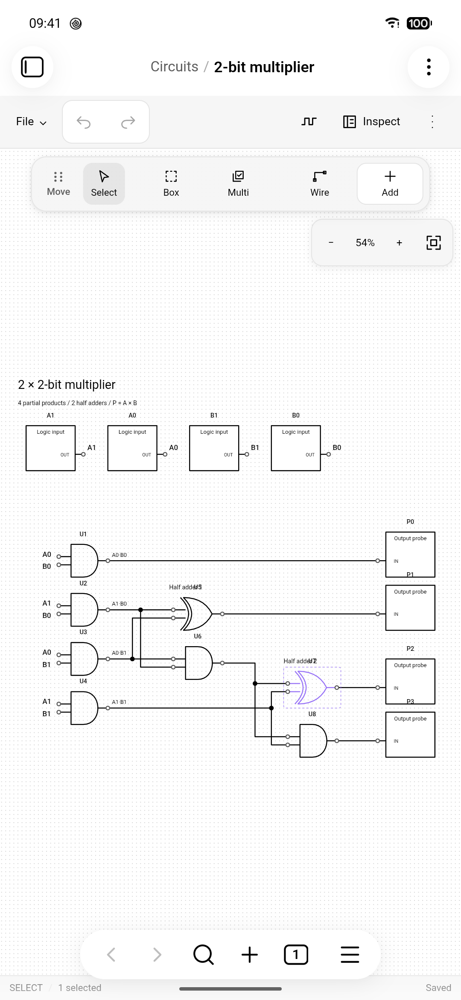</a>
  <a href="docs/screenshots/phone-3-logic-simulation.png">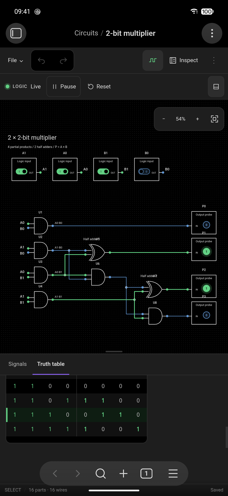</a>
  <a href="docs/screenshots/phone-4-electrical-build.png">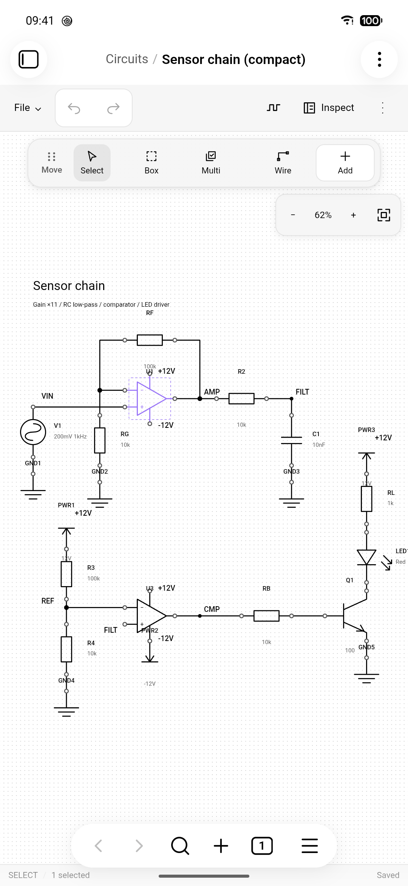</a>
  <a href="docs/screenshots/phone-5-electrical-simulation.png">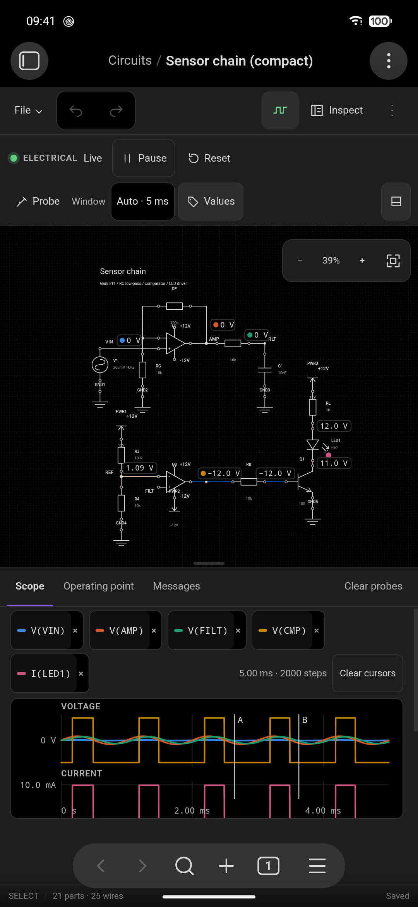</a>

Every screenshot is a real capture in Obsidian. [See all screenshots and their editable circuits](docs/screenshots/README.md).

## Powerful tools, clean workspace

- **Intuitive from the first circuit.** Find parts by name, preview a symbol, then click or tap to place and connect. Clear pin targets and brief visual feedback confirm each action.
- **Electrical and logic together.** Power supplies, op-amp stages, transistor drivers and gate-level logic from 72 built-in symbols. Define custom ICs, map bus lanes and reuse your own snippets.
- **Simulation as an analysis tool.** Electrical circuits get a DC operating point and a transient scope with probes, cursors and measurements; logic circuits get four-state signals, live switches and exhaustive truth tables. Values accept engineering notation such as `4k7`, `100nF` or `5V 1kHz`.
- **Precise editing as circuits grow.** Move, rotate and mirror connected parts, select regions and group objects. Alignment guides, undo/redo and structural checks help you refine larger schematics.
- **Control over every connection.** Route around components, choose your own bends, branch through explicit junctions and name nets. Crossed wires stay separate until you join them.
- **Diagrams that belong in your notes.** Embed live previews, export SVG or PNG for reports and lessons, and keep every circuit file in your vault.

## Installation

In Obsidian, open **Settings → Community plugins → Browse**, search for **Logic-Electric Circuit Builder**, then select **Install** and **Enable**. Requires Obsidian 1.14.0 or later.

## Usage

Open a new circuit with the ribbon icon or **Logic-Electric Circuit Builder: New circuit** in the command palette. Choose **Add**, pick a part from **Electrical**, **Logic** or **Connections**, place it, and tap two pins to connect them. Choose **Simulate** in the top bar to run the circuit; **Build** returns to editing. Simulation never changes the saved file.

From a note, run **Insert circuit preview** to bring the drawing into your notes. Read the [simulation guide](docs/simulation.md) for supported models, or follow the [editing and shortcuts guide](docs/user-guide.md).

Have an idea or found a problem? Open **More → Send feedback** in the circuit editor to help shape the next update.

Simulation supports combinational logic and the electrical models listed in the guide. It is a learning and analysis aid, not a substitute for SPICE sign-off or hardware testing.

Created by **Hamza**. [MIT licensed](LICENSE). [Contributing and technical documentation](CONTRIBUTING.md).
