# Logic-Electric Circuit Builder

**Draw circuits inside Obsidian, on desktop, tablet and phone.**

A clean, intuitive workspace with the tools to build complete electrical and logic schematics. Search 72 symbols, create your own ICs, and reshape connected circuits with precise wire routing. Keep your diagrams beside the notes that explain them, with everything offline and in your vault.

**72 built-in symbols · Custom IC blocks · Explicit bus lanes · Live note previews · SVG & PNG export**

## Your circuits, inside your notes

Explain the topic around the drawing. Embed a live circuit preview in a study note, lab notebook or project write-up, and open the original whenever you want to edit it.

**Logic · light theme.** A four-bit ripple-carry adder, its gate-level connections, worked arithmetic and an explanation of delay and overflow.

[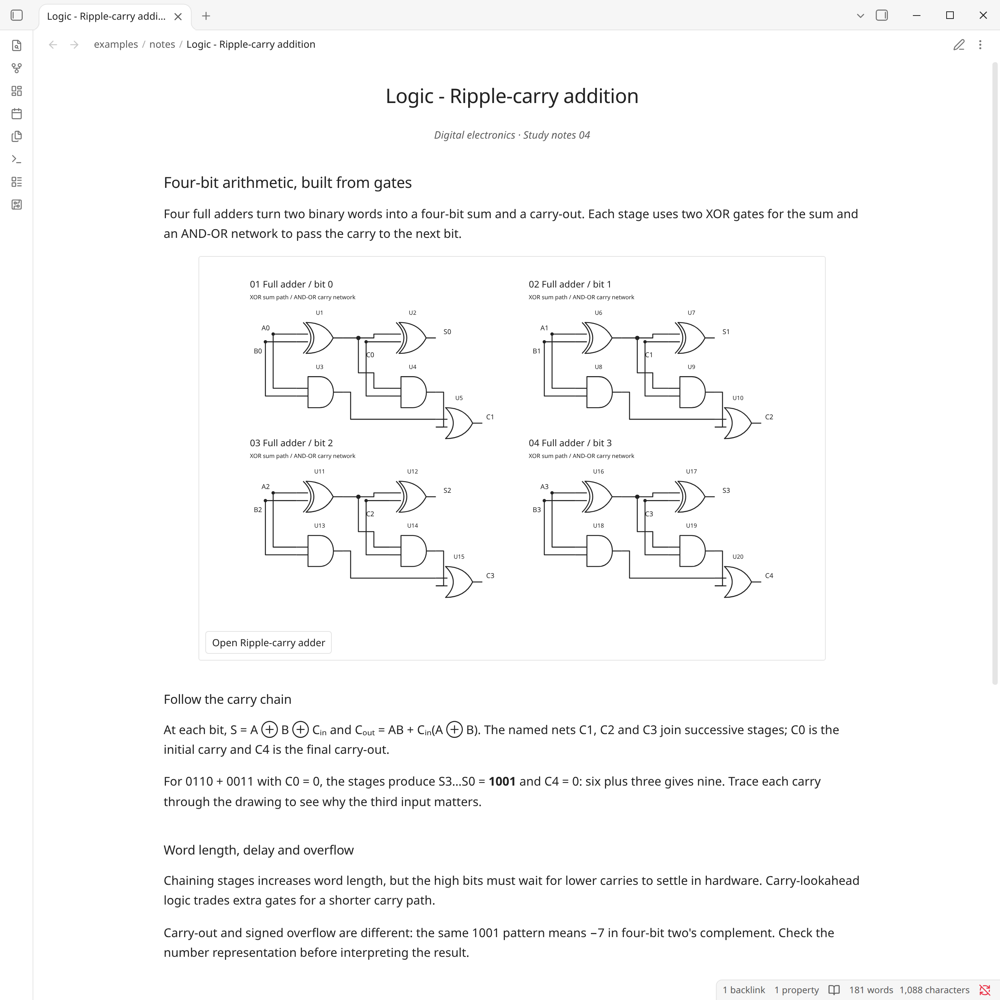](docs/screenshots/note-logic-light.png)

**Electrical · dark theme.** A complete photodiode signal chain with filtering, amplification and threshold detection, plus component calculations and lab questions.

[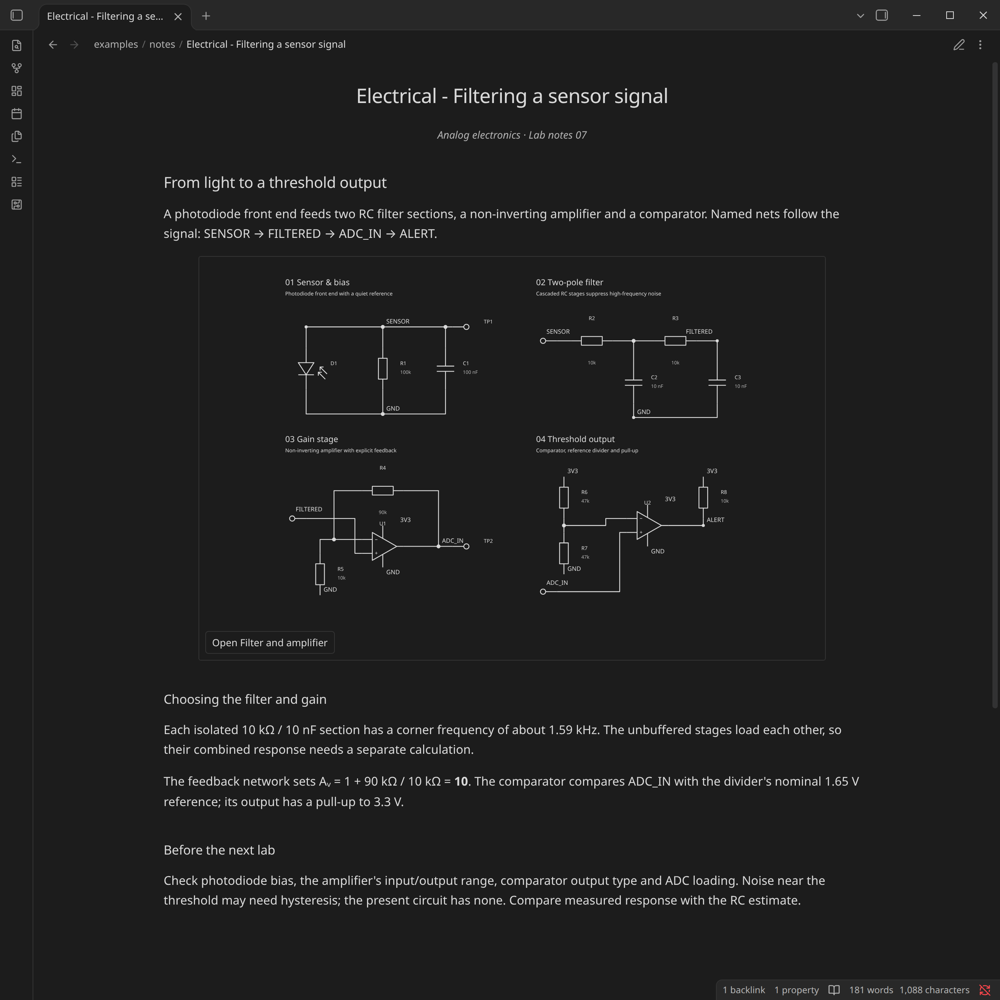](docs/screenshots/note-electrical-dark.png)

[Try these example notes and editable circuits](examples/notes/README.md).

## From electrical circuits to digital logic

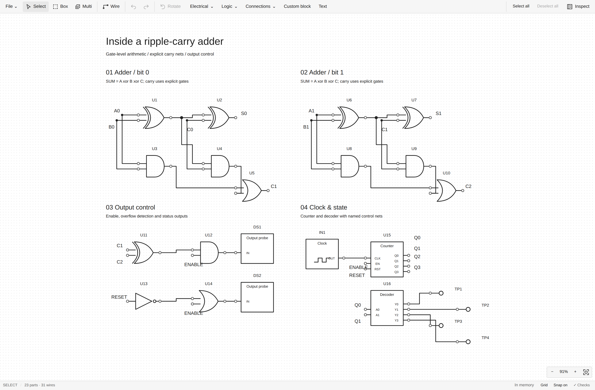

| Power supplies | Analog signal chains |
| --- | --- |
| [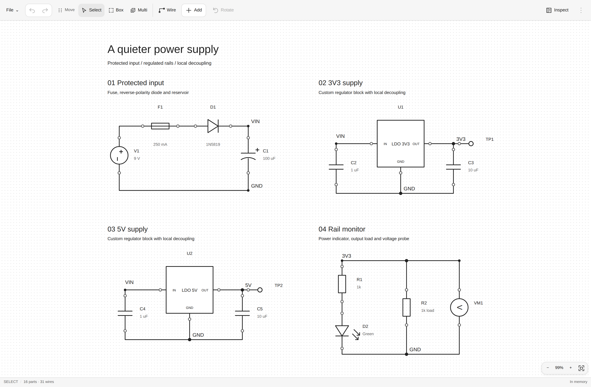](docs/screenshots/desktop-power.png) | [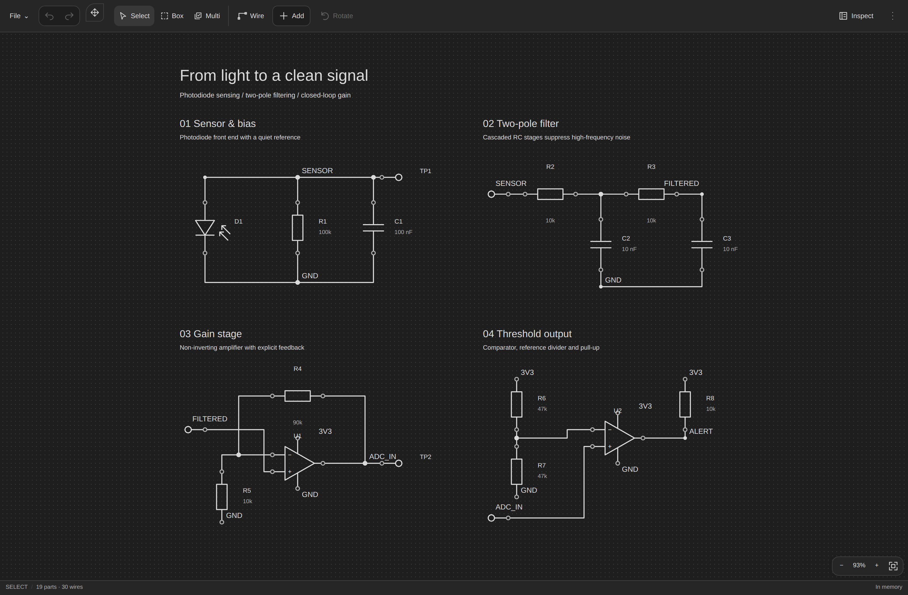](docs/screenshots/desktop-analog.png) |
| **Custom blocks & 8-bit buses** | **Timers & transistor drivers** |
| [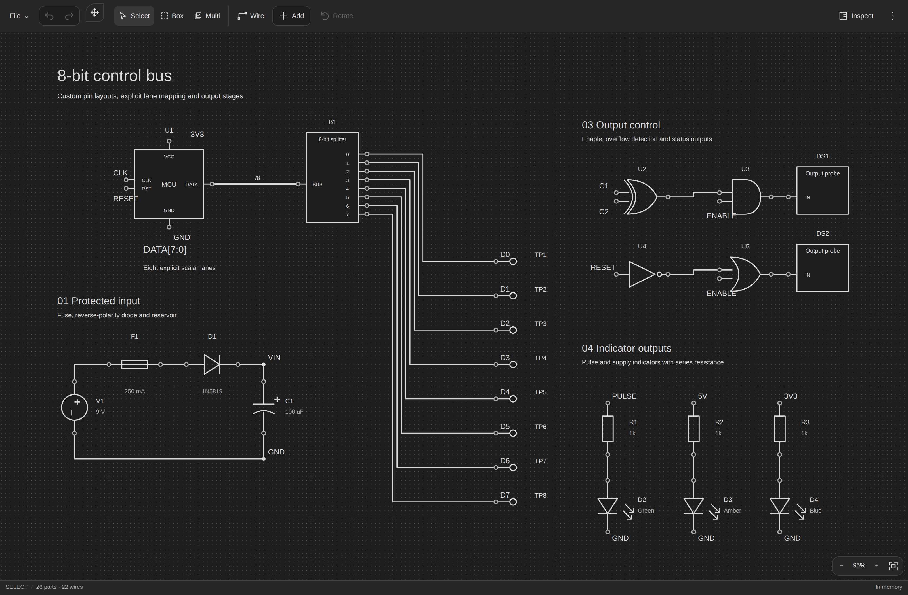](docs/screenshots/desktop-bus.png) | [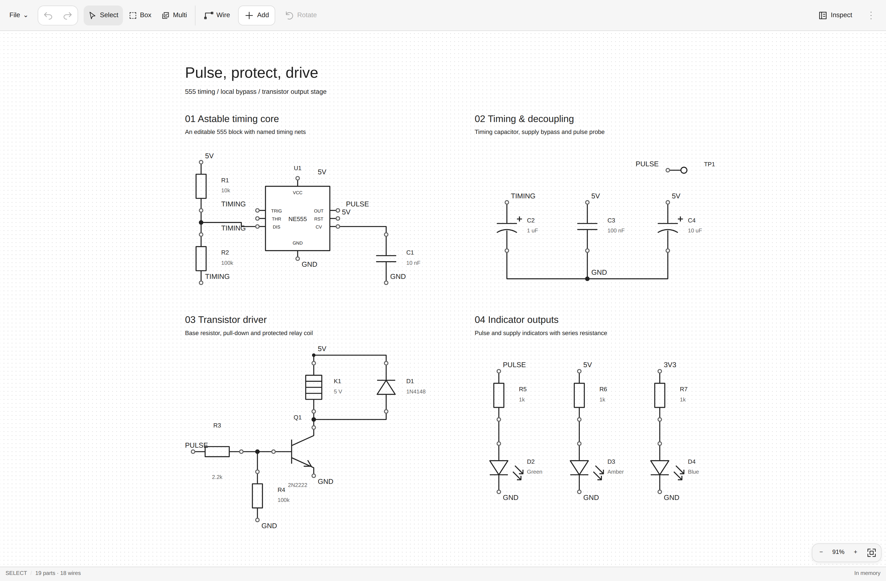](docs/screenshots/desktop-timer.png) |

## Take your circuits with you

The same circuit tools on a screen that suits you. Swipe to pan, pinch to zoom, and tap to place parts or connect pins. A dockable toolbar keeps the main tools together on smaller screens, defaulting to the top, with Undo/Redo always above and properties a tap away.

  <a href="docs/screenshots/mobile-power.png">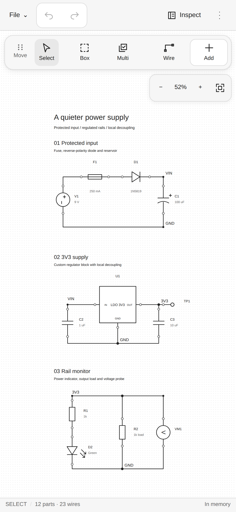</a>
  <a href="docs/screenshots/mobile-analog.png">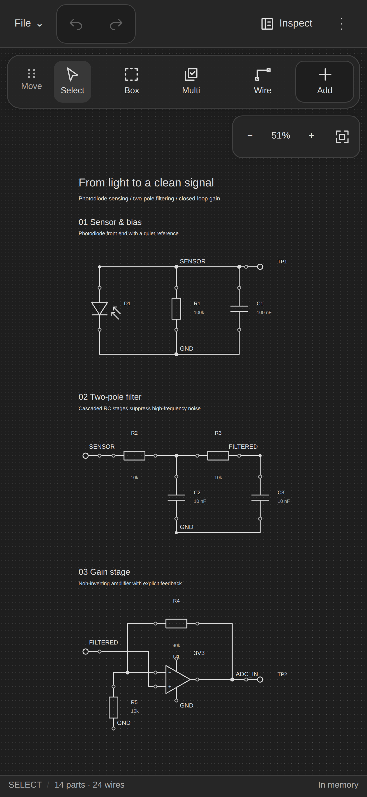</a>
  <a href="docs/screenshots/mobile-logic.png">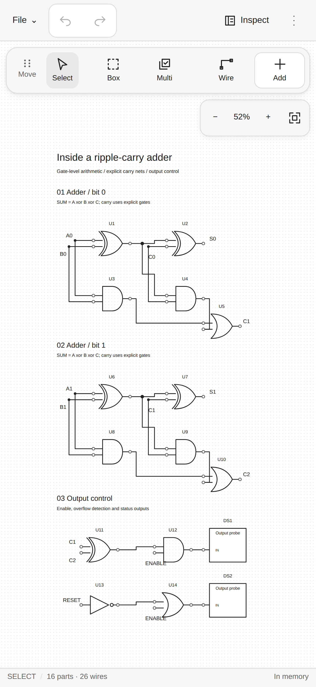</a>
  <a href="docs/screenshots/mobile-bus.png">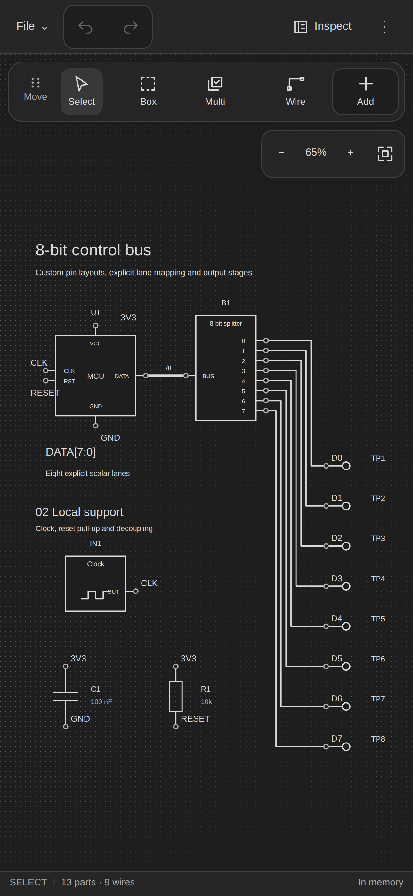</a>
  <a href="docs/screenshots/mobile-timer.png">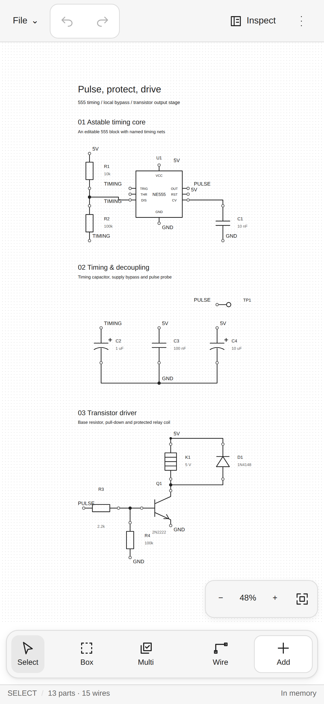</a>

Click any image for full resolution, or [explore all twelve screenshots and editable examples](docs/screenshots/README.md).

## Powerful tools, clean workspace

- **Intuitive from the first circuit.** Find parts by name, choose a symbol preview, then click or tap to place and connect. Clear pin targets and brief visual feedback help you see each action.
- **Electrical and logic together.** Build power supplies, analog signal chains and digital logic with 72 built-in symbols. Define custom ICs, map bus lanes and reuse your own circuit snippets.
- **Organized around your drawing.** Related tools stay together in a compact toolbar. Open properties when you need them, work in your Obsidian theme, and keep the canvas spacious.
- **Precise editing as circuits grow.** Move, rotate and mirror connected parts, select regions and group objects. Use alignment guides, undo/redo and structural checks to refine larger schematics.
- **Control over every connection.** Route around components, choose your own wire bends, branch through explicit junctions and name nets. Crossed wires stay separate until you join them.
- **Diagrams that belong in your notes.** Embed live circuit previews, then export SVG or PNG for lessons, reports and sharing. Your circuit files stay in your vault, ready to edit again.

## Installation

In Obsidian, open **Settings → Community plugins → Browse**, search for **Logic-Electric Circuit Builder**, then select **Install** and **Enable**. Requires Obsidian 1.14.0 or later.

## Usage

Open a new circuit with the ribbon icon or **Logic-Electric Circuit Builder: New circuit** in the command palette. Choose **Add**, pick a part from **Electrical**, **Logic** or **Connections**, place it, and tap two pins to connect them.

From a note, run **Insert circuit preview** to bring the drawing into your notes. Explore the [editable example circuits](examples/showcase/README.md) for ideas, or follow the [editing and shortcuts guide](docs/user-guide.md).

Have an idea or found a problem? Open **More → Send feedback** in the circuit editor to help shape the next update.

Built for schematic drawing and documentation. Simulation is outside its scope.

Created by **Hamza**. [MIT licensed](LICENSE). [Contributing and technical documentation](CONTRIBUTING.md).
